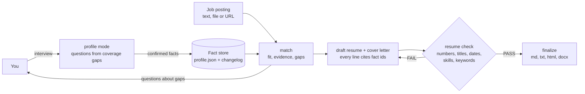

# 🪪 career-profiler

**Facts in, tailored applications out.** One Agent Skill that interviews you into a career fact
store, then writes a resume and cover letter for any specific job posting and proves every line
against that store. Works for any profession, in Claude Code, GitHub Copilot and OpenAI Codex,
on Windows, macOS and Linux.

[](LICENSE)
[](https://agentskills.io/specification)

Version 0.1.0 (2026-10-29), the first release. The skill lives in
[`skills/career-profiler/`](skills/career-profiler/SKILL.md) and ships only runtime files
(`SKILL.md`, `references/`, `scripts/`, `assets/`); its tests, evals and changelog stay at the
repository root and are never installed.

## 🧭 What it is

Models write convincing resumes, which is the problem: asked for "React lead" they produce a
React lead, whether or not you were one. This skill separates the two jobs. **`profile`**
interviews you, a few questions at a time, and saves only what you confirm into a validated,
backed-up, hash-chained fact store. **`resume`** takes one job posting (pasted, attached or
linked), measures the fit, asks about the gaps, writes the resume and cover letter from the
store with a `<!-- fact: id -->` citation on every line, and runs `resume check`: a line with a
number, title, date, employer, skill or keyword the cited facts do not support fails, and
`finalize` refuses a failing draft.



## ✨ Features

**Career profile**

- 🗣️ **Interview-driven**: `interview coverage` scores the store and orders the gaps; the
  question bank is role-agnostic with domain probes (engineering, healthcare, sales, trades,
  education and more) chosen from your own titles.
- 📥 **Import**: an old resume or LinkedIn export becomes unconfirmed candidate facts that you
  confirm one by one; nothing unconfirmed ever reaches a resume.
- 🧾 **A real fact store**: `career-profile/1` JSON with ids, provenance, metrics on every
  achievement, validated on every write, a backup before every write, a hash-chained changelog,
  owner-only permissions, and `store sync` for a dedicated private repository.

**Tailored applications**

- 📄 **Any posting**: pasted text, HTML, a file or a URL becomes `job.json` with must-have and
  nice-to-have keywords, seniority, years and requirement lines (170+ taxonomy terms plus your
  own skill names).
- 🎯 **Match first**: fit score, evidence ids per requirement, seniority and years verdicts, and
  a question per gap to ask you before anything is written.
- ✍️ **Draft, check, finalize**: a draft with every structural fact already cited and bullets
  ordered by relevance; a checker that fails fabrications (wrong numbers, inflated titles,
  shifted dates, misattributed achievements, unsupported skills and keywords) and reports
  unused supported keywords; outputs in Markdown, plain text (ATS), HTML (print to PDF) and
  DOCX (with pandoc).
- 💌 **Cover letter** every time, cited and checked; using it is your call.

## 🚀 Install

You need **Node.js 22+** on `PATH` for the scripts (without it the skill works in
guidance-only mode) and a supported host. Optional: pandoc for `.docx`.

**Claude Code** (project `.claude/skills/`, or user scope with `--scope user`):

```bash
gh skill install robertlemmermann/career-profiler career-profiler --agent claude-code --scope user
```

**GitHub Copilot** (CLI, VS Code, cloud agent; `.github/skills/` for code review):

```bash
gh skill install robertlemmermann/career-profiler career-profiler --scope user
```

**Codex** (`.agents/skills/`, or `~/.agents/skills/` with `--scope user`):

```bash
gh skill install robertlemmermann/career-profiler career-profiler --agent codex --scope user
```

No `gh`? `npx skills add robertlemmermann/career-profiler -a claude-code -a github-copilot -a codex --copy -g`,
or clone and copy `skills/career-profiler/` into the host's skills directory:

```bash
git clone --depth 1 https://github.com/robertlemmermann/career-profiler "$HOME/career-profiler-src" && mkdir -p "$HOME/.claude/skills" && cp -R "$HOME/career-profiler-src/skills/career-profiler" "$HOME/.claude/skills/"
```

```powershell
git clone --depth 1 https://github.com/robertlemmermann/career-profiler "$env:USERPROFILE\career-profiler-src"; New-Item -ItemType Directory -Force "$env:USERPROFILE\.claude\skills" | Out-Null; Copy-Item -Recurse "$env:USERPROFILE\career-profiler-src\skills\career-profiler" "$env:USERPROFILE\.claude\skills\"
```

Check it: `node ~/.claude/skills/career-profiler/scripts/cp.mjs doctor`.

## 🎛️ Use

| Say | What happens |
|---|---|
| `/career-profiler profile` | the interview starts (or continues) and writes confirmed facts to the store |
| `/career-profiler profile import resume-2024.pdf` | facts are extracted as unconfirmed and confirmed with you |
| `/career-profiler resume <paste the posting, or a path, or a URL>` | match, gap questions, cited resume and cover letter, check, finalize |
| `/career-profiler match <posting>` | fit and gaps only: should you apply |
| `/career-profiler store path` · `store validate` · `doctor` | where the data is, whether it is intact |

Codex: `$career-profiler <mode>`. Plain language works too ("I got promoted, update my
profile"; "am I a fit for this?" with a posting).

**Run the scripts yourself** (the skill runs them for you):

```bash
CP=~/.claude/skills/career-profiler/scripts/cp.mjs
node "$CP" store init --name "Your Name"
node "$CP" interview next --max 3
node "$CP" job parse posting.txt --out job.json && node "$CP" match job.json
node "$CP" app new job.json          # applications/<date>-<slug>/ with drafts
node "$CP" resume check applications/*/resume.md --job job.json
node "$CP" resume finalize applications/*/resume.md --formats md,txt,html,docx
```

Every command prints one JSON document with `--json`; exit codes are `0` ok, `1` findings,
`2` usage, `3` environment missing, `4` could not verify
([host notes](skills/career-profiler/references/host-notes.md)).

## 📁 Where your data lives

A directory with `profile.json`, `changelog.jsonl`, `backups/`, `documents/` and
`applications/`. It resolves as `--store`, then `CAREER_PROFILER_HOME`, then a `profile.json`
in the current directory, then `~/.career-profiler/`. It is personal data: the skill keeps it
out of project repositories (`doctor` warns, `store sync` refuses) and never sends it anywhere.

| You want | Do this |
|---|---|
| One computer | nothing; `~/.career-profiler/` is created on first use |
| Several computers, **phone or tablet** | create a private repository (for example `career-profile`), install the skill into it, run `store init` inside it, `store sync` after sessions; open it in Claude Code on the web or in the Claude app, Copilot cloud or Codex cloud and ask for a resume |
| Give it to a friend | they install the skill and say `/career-profiler profile`; every store is separate |
| A database | not needed for one person's few hundred facts; see [storage](skills/career-profiler/references/storage.md) §6 |

## 🧪 Testing the skill itself

From a clone (tests and evals are never installed):

```bash
node tests/selftest.mjs                 # footprint, frontmatter, scripts, evals layout, readme, release, unit tests
node --test "tests/unit/*.test.mjs"     # 37 unit tests over fixtures: profiles, postings, resumes
node tests/run-evals.mjs                # paid: claude plugin eval on a temp copy of the skill
node tests/run-trigger-set.mjs --dry-run   # the 20-query trigger set; drop --dry-run to run it (paid)
node tests/live/interview-sim.mjs --persona icu-nurse --turns 8   # paid: a simulated candidate is interviewed, the store is graded
```

The eval cases are under [`evals/`](evals/): nine shell-free `claude plugin eval` cases
(triggering, no fabrication, gap questions, a nurse role, promotion updates, match-only, no
posting) and one shell case (`scripts-pipeline`, needs `--scaffold`, `--allow-tools` and the OS
sandbox). Results and costs of the last run are in [CHANGELOG.md](CHANGELOG.md).

## 📜 License

Apache-2.0. Built with the same conventions as
[agentic-developer-companion](https://github.com/robertlemmermann/agentic-developer-companion).
