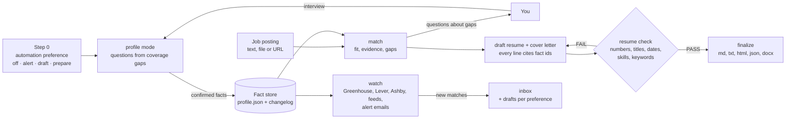

# 🪪 career-profiler

**Facts in, tailored applications out, nothing sent without you.** One Agent Skill that
interviews you into a career fact store, writes a resume and cover letter for any specific job
posting and proves every line against that store, and watches the job sources you choose with
drafts ready for review. Works for any profession, in Claude Code, GitHub Copilot and OpenAI
Codex, on Windows, macOS and Linux.

[](LICENSE)
[](https://agentskills.io/specification)

Version 0.2.0 (2026-10-29). The skill lives in
[`skills/career-profiler/`](skills/career-profiler/SKILL.md) and ships only runtime files
(`SKILL.md`, `references/`, `scripts/`, `assets/`); its tests, evals and changelog stay at the
repository root and are never installed.

## 🧭 What it is

Models write convincing resumes, which is the problem: asked for "React lead" they produce a
React lead, whether or not you were one. This skill separates the jobs. **`profile`**
interviews you, a few questions at a time, and saves only what you confirm (staged, shown,
committed with `--confirm`) into a validated, backed-up, hash-chained fact store. **`resume`**
takes one job posting (pasted, attached or linked), measures the fit, asks about the gaps (five
at most), writes the resume and cover letter from the store with a `<!-- fact: id -->` citation
on every line, and runs `resume check`: a line with a number, title, date, employer, skill,
keyword, strength of claim or personal detail the cited facts do not support fails, and
`finalize` refuses a failing draft. **`watch`** polls company boards, feeds and your own
job-alert emails without a model and puts matches in an inbox with drafts, as far as the
automation preference you recorded allows. The first thing the skill ever does for you is ask
that preference; it never submits an application in any mode.



## ✨ Features

**Career profile**

- 🗣️ **Interview-driven**: `interview coverage` scores the store and orders the gaps; the
  question bank is role-agnostic with domain probes (engineering, healthcare, sales, trades,
  education and more) chosen from your own titles.
- 📥 **Import**: an old resume or LinkedIn export becomes unconfirmed candidate facts that you
  confirm one by one; nothing unconfirmed ever reaches a resume.
- 🧾 **A real fact store**: `career-profile/1` JSON with ids, provenance, metrics on every
  achievement, validated on every write, a backup before every write, a hash-chained changelog,
  owner-only permissions, and `store sync` for a dedicated private repository.

**Tailored applications**

- 📄 **Any posting**: pasted text, HTML, a file or a URL becomes `job.json` with must-have and
  nice-to-have keywords, seniority, years and requirement lines (170+ taxonomy terms plus your
  own skill names).
- 🎯 **Match first**: fit score, evidence ids per requirement, seniority and years verdicts, and
  a question per gap to ask you before anything is written.
- ✍️ **Draft, check, finalize**: a draft with every structural fact already cited and bullets
  ordered by relevance; a checker that fails fabrications (wrong numbers, inflated titles,
  shifted dates, misattributed achievements, unsupported skills and keywords) and reports
  unused supported keywords; outputs in Markdown, plain text (ATS), HTML (print to PDF) and
  DOCX (with pandoc).
- 💌 **Cover letter** every time, cited and checked; using it is your call.
- 🧾 **No overclaiming**: "led", "owned" or "expert" must be in the cited fact (`exceeds`); an
  expired licence is never listed as current.

**Job sources**

- 📡 **Legal sources only**: Greenhouse, Lever, Ashby, SmartRecruiters, Workable boards;
  Remotive, Arbeitnow, USAJobs, Adzuna, Hacker News; any RSS feed; your own alert emails from
  Indeed, Glassdoor or LinkedIn saved as files. Those three boards themselves are refused (their
  terms), with the alternative named.
- 🔔 **Your preference rules**: `off`, `alert` (inbox only), `draft` (cited drafts for review),
  `prepare` (plus cited screening answers you paste). Recorded in your words before anything
  else runs; nothing is ever submitted.
- ⏱️ **Polling needs no model**: a cron line, Task Scheduler, launchd or a GitHub Actions
  schedule in your private store repository; the skill prints the snippets and installs nothing.
  Requests carry your search terms only, never profile data.

**Privacy**

- 🔒 **Tiers**: every fact is `professional`, `restricted` (work authorization, salary: released
  only on a confirmed `--include` for one document) or `never` (date of birth, ids, address,
  health, family: never leaves the store). The interview does not ask for the never list; what
  you volunteer is stored at tier never.
- 🕵️ **Scans**: 19 detectors plus the exact values of protected facts run inside every check,
  finalize, export and outbound request.

## 🚀 Install

You need **Node.js 22+** on `PATH` for the scripts (without it the skill works in
guidance-only mode) and a supported host. Optional: pandoc for `.docx`.

**Claude Code** (project `.claude/skills/`, or user scope with `--scope user`):

```bash
gh skill install robertlemmermann/career-profiler career-profiler --agent claude-code --scope user
```

**GitHub Copilot** (CLI, VS Code, cloud agent; `.github/skills/` for code review):

```bash
gh skill install robertlemmermann/career-profiler career-profiler --scope user
```

**Codex** (`.agents/skills/`, or `~/.agents/skills/` with `--scope user`):

```bash
gh skill install robertlemmermann/career-profiler career-profiler --agent codex --scope user
```

No `gh`? `npx skills add robertlemmermann/career-profiler -a claude-code -a github-copilot -a codex --copy -g`,
or clone and copy `skills/career-profiler/` into the host's skills directory:

```bash
git clone --depth 1 https://github.com/robertlemmermann/career-profiler "$HOME/career-profiler-src" && mkdir -p "$HOME/.claude/skills" && cp -R "$HOME/career-profiler-src/skills/career-profiler" "$HOME/.claude/skills/"
```

```powershell
git clone --depth 1 https://github.com/robertlemmermann/career-profiler "$env:USERPROFILE\career-profiler-src"; New-Item -ItemType Directory -Force "$env:USERPROFILE\.claude\skills" | Out-Null; Copy-Item -Recurse "$env:USERPROFILE\career-profiler-src\skills\career-profiler" "$env:USERPROFILE\.claude\skills\"
```

Check it: `node ~/.claude/skills/career-profiler/scripts/cp.mjs doctor`.

## 🎛️ Use

| Say | What happens |
|---|---|
| `/career-profiler setup` | record or change the automation preference (the first thing the skill asks) |
| `/career-profiler profile` | the interview starts (or continues) and writes confirmed facts to the store |
| `/career-profiler profile import resume-2024.pdf` | facts are extracted as unconfirmed and confirmed with you |
| `/career-profiler resume <paste the posting, or a path, or a URL>` | match, gap questions, cited resume and cover letter, check, finalize |
| `/career-profiler match <posting>` | fit and gaps only: should you apply |
| `/career-profiler watch add --source greenhouse --board acme` · `watch poll` · `watch inbox` | subscribe, poll, review matches and drafts |
| `/career-profiler store path` · `store validate` · `doctor --repair` | where the data is, whether it is intact, repair what a script can |

Codex: `$career-profiler <mode>`. Plain language works too ("I got promoted, update my
profile"; "am I a fit for this?" with a posting).

**Run the scripts yourself** (the skill runs them for you):

```bash
CP=~/.claude/skills/career-profiler/scripts/cp.mjs
node "$CP" store init --name "Your Name"
node "$CP" gate record --automation draft --statement "Draft things for me to review; never send anything." --confirm
node "$CP" interview next --max 3
node "$CP" fact stage experience --data '{"employer":"Acme","title":"Nurse","start":"2020-08"}' --quote "nurse at Acme since August 2020"
node "$CP" fact commit T-001 --confirm
node "$CP" job parse posting.txt --out job.json && node "$CP" match job.json
node "$CP" app new job.json          # applications/<date>-<slug>/ with drafts
node "$CP" resume check applications/*/resume.md --job job.json
node "$CP" resume finalize applications/*/resume.md --formats md,txt,html,json,docx
node "$CP" watch add --source greenhouse --board acme && node "$CP" watch poll
```

Every command prints one JSON document with `--json`; exit codes are `0` ok, `1` findings,
`2` usage, `3` environment missing, `4` could not verify
([host notes](skills/career-profiler/references/host-notes.md)).

## 📁 Where your data lives

A directory with `profile.json`, `preferences.json`, `changelog.jsonl`, `MANIFEST.json`,
`backups/`, `documents/`, `applications/`, `watch/`, `inbox/` and `quarantine/`. It resolves as
`--store`, then `CAREER_PROFILER_HOME`, then a `profile.json` in the current directory, then
`~/.career-profiler/`. It is personal data: the skill keeps it out of project repositories
(`doctor` warns, `store sync` refuses) and never sends it anywhere. Every write validates,
backs up, logs a hash-chained entry and rewrites the manifest; `doctor --repair` fixes
directories, permissions, a broken chain or manifest drift and logs what it did.

| You want | Do this |
|---|---|
| One computer | nothing; `~/.career-profiler/` is created on first use |
| Several computers, **phone or tablet** | create a private repository (for example `career-profile`), install the skill into it, run `store init` inside it, `store sync` after sessions; open it in Claude Code on the web or in the Claude app, Copilot cloud or Codex cloud and ask for a resume |
| Give it to a friend | they install the skill and say `/career-profiler profile`; every store is separate |
| A database | not needed for one person's few hundred facts; see [storage](skills/career-profiler/references/storage.md) §6 |

## 🔒 Privacy

Only the facts you confirm are stored, in your words (`provenance.quote`). Restricted facts
(work authorization, relocation, salary expectations, licence numbers) are masked in views and
exports and released only for one document after you say yes. Never-tier facts (date of birth,
age, national ids, street address, marital or family status, religion, health, ethnicity,
photo, bank details) are never asked for, are quarantined if you volunteer them, and never leave
the store. Every check, finalize, export and outbound request is scanned; the changelog holds
ids and hashes, never values. Details: [privacy](skills/career-profiler/references/privacy.md).

## 📡 Job boards

Indeed, Glassdoor and LinkedIn have no public job APIs and their terms forbid bots and
automated applying, so the skill refuses them and says why; their own job-alert emails, saved
into the store's inbox, are the honest substitute. Company boards (Greenhouse, Lever, Ashby,
SmartRecruiters, Workable), aggregators with free keys (Adzuna, USAJobs), Remotive, Arbeitnow,
Hacker News and any RSS feed are polled by a plain script under your scheduler. Matches are
scored against your profile; with `draft` or `prepare` you get cited drafts (and screening
answers) to review. The skill never applies for you: it is refused in every mode. Options and
their trade-offs: [sources](skills/career-profiler/references/sources.md).

## 🧪 Testing the skill itself

From a clone (tests and evals are never installed):

```bash
node tests/selftest.mjs                 # footprint, playbooks, honeypots, ledger, frontmatter, scripts, assets, evals, readme, release, unit tests
node --test "tests/unit/*.test.mjs"     # unit tests over fixtures: three profiles, five postings, resumes, feeds, stores
node tests/run-evals.mjs                # paid: claude plugin eval on a temp copy of the skill (threshold 1, sonnet judge)
node tests/run-trigger-set.mjs --dry-run   # the 32-query trigger set; drop --dry-run to run it (paid); --host copilot|codex
node tests/live/interview-sim.mjs --persona icu-nurse --sim deterministic   # paid (16 turns): a scripted candidate is interviewed, the store is graded
```

The eval cases are under [`evals/`](evals/): thirty-eight shell-free `claude plugin eval` cases
(triggering, the gate first in every mode and on corruption or degradation, confirm before any
write, headless runs, no fabrication or overclaiming, gap questions, declined gaps, expired
credentials, a nurse and an electrician, promotion updates, match-only and skip advice, no
posting, refused auto-apply and the preference ceiling, board subscriptions and schedulers,
volunteered PII and posting bait, never editing or dumping the store, storage questions,
plain-language routing) and one shell case (`scripts-pipeline`, run by `claude plugin eval --scaffold` or, where its OS sandbox cannot write, by `tests/live/pipeline-sim.mjs`; plugin eval needs `--scaffold`,
`--allow-tools` and the OS sandbox). Every
runner appends to the results ledger in [`evals/ledger/`](evals/ledger/README.md); the release
rule is in [release](skills/career-profiler/references/release.md).

## 📜 License

Apache-2.0. Built with the same conventions as
[agentic-developer-companion](https://github.com/robertlemmermann/agentic-developer-companion).
